# ENTITY RELATIONSHIP DIAGRAM (ERD) — BUMI UPI CRM
**Studi Kasus:** Rumah Tamah Bumi Upi, Garut, Jawa Barat  
**Basis Data:** PostgreSQL (Supabase)  
**Zona Waktu:** WIB (Asia/Jakarta, UTC+7)

---

## 1. Diagram Konseptual & Logikal (Mermaid)

```mermaid
erDiagram
    PROFILES ||--o{ TRANSACTIONS : "melakukan (customer)"
    PROFILES ||--o{ TRANSACTIONS : "mencatat (cashier)"
    PROFILES ||--o{ CUSTOMER_VOUCHERS : "memiliki"
    PROFILES ||--o{ POINTS_LEDGER : "memiliki mutasi"
    PROFILES ||--o{ RESERVATIONS : "memesan"
    PROFILES ||--o{ EVENT_RSVPS : "mendaftar"
    PROFILES ||--o{ CUSTOMER_FEEDBACK : "memberikan"
    PROFILES ||--|| RFM_SCORES : "memiliki skor"
    PROFILES ||--o{ CAMPAIGNS : "dibuat oleh (admin)"
    PROFILES ||--o{ AUDIT_LOGS : "pelaku aksi (staff)"

    MENU_CATEGORIES ||--o{ MENU_ITEMS : "mengelompokkan"
    MENU_ITEMS ||--o{ TRANSACTION_ITEMS : "terkandung dalam"

    TRANSACTIONS ||--|{ TRANSACTION_ITEMS : "memiliki baris menu"
    TRANSACTIONS ||--o| CUSTOMER_VOUCHERS : "menggunakan"
    TRANSACTIONS ||--o{ POINTS_LEDGER : "memicu poin"
    TRANSACTIONS ||--o| CUSTOMER_FEEDBACK : "dinilai oleh"

    VOUCHERS ||--o{ CUSTOMER_VOUCHERS : "instance kupon"
    VOUCHERS ||--o{ EVENTS : "voucher terkait"

    EVENTS ||--o{ EVENT_RSVPS : "kehadiran peserta"

    PROFILES {
        uuid id PK
        string role "customer, kasir, admin"
        string name
        string email UK
        string phone
        boolean is_phone_verified
        bigint telegram_chat_id UK
        string telegram_username
        string tier "Tamu, Sahabat, Keluarga"
        int points_balance
        int cumulative_points
        string qr_code UK
        date birth_date
        boolean opt_in_promo
        timestamptz created_at
    }

    MENU_ITEMS {
        uuid id PK
        uuid category_id FK
        string name
        string description
        int price
        boolean is_available
        boolean is_featured
        string image_url
    }

    TRANSACTIONS {
        uuid id PK
        uuid customer_id FK
        uuid cashier_id FK
        string invoice_number UK
        string idempotency_key UK
        int subtotal
        int discount_amount
        int final_amount
        int points_earned
        uuid voucher_id FK
        string status "completed, cancelled"
        timestamptz created_at
    }

    TRANSACTION_ITEMS {
        uuid id PK
        uuid transaction_id FK
        uuid menu_item_id FK
        string item_name
        int unit_price
        int quantity
        int subtotal
    }

    POINTS_LEDGER {
        uuid id PK
        uuid customer_id FK
        uuid transaction_id FK
        int points_change
        string reason "transaction, welcome_bonus, birthday, voucher_redemption, manual_adjustment"
        int balance_after
        timestamptz created_at
    }

    VOUCHERS {
        uuid id PK
        string code UK
        string title
        string discount_type "nominal, percent, free_item"
        int discount_value
        int min_spend
        int quota
        int claimed_count
        int redeemed_count
        timestamptz valid_until
        string target_tier
        string target_rfm_segment
    }

    CUSTOMER_VOUCHERS {
        uuid id PK
        uuid customer_id FK
        uuid voucher_id FK
        string unique_code UK
        string qr_code
        boolean is_redeemed
        timestamptz redeemed_at
        uuid transaction_id FK
        timestamptz expires_at
    }

    RESERVATIONS {
        uuid id PK
        uuid customer_id FK
        string guest_name
        string guest_phone
        date reservation_date
        time reservation_time
        int guest_count
        string seating_area
        string status "menunggu, dikonfirmasi, selesai, batal"
        string special_notes
    }

    CUSTOMER_FEEDBACK {
        uuid id PK
        uuid customer_id FK
        uuid transaction_id FK
        int rating "1-5"
        string category "rasa, pelayanan, suasana, umum"
        string comment
        string sentiment "positif, netral, negatif"
        string status "baru, diproses, selesai"
        string admin_response
    }

    RFM_SCORES {
        uuid id PK
        uuid customer_id FK
        int recency_days
        int frequency_count
        bigint monetary_total
        int r_score "1-5"
        int f_score "1-5"
        int m_score "1-5"
        string rfm_segment "Champions, Loyal, Potensial Loyal, Baru, Berisiko, Hampir Hilang, Hilang"
        bigint clv_estimate
        timestamptz calculated_at
    }

    TELEGRAM_UPDATES {
        bigint update_id PK
        timestamptz processed_at
        jsonb update_payload
    }

    AUDIT_LOGS {
        uuid id PK
        uuid staff_id FK
        string staff_name
        string action
        string target_entity
        string target_id
        jsonb details
        timestamptz created_at
    }
```

---

## 2. Penjelasan Relasi & Integritas Kritis

1. **Idempotency & Anti-Duplikasi Poin:**
   - Tabel `transactions` memiliki `idempotency_key` unik. Transaksi kasir dengan key yang sama tidak akan diproses ulang, menjaga integritas poin dan neraca keuangan.
2. **Kupon Sekali Pakai (Single-Use Vouchers):**
   - Tabel `customer_vouchers` memisahkan master voucher dari voucher yang dimiliki pelanggan. Kolom `is_redeemed`, `redeemed_at`, dan row-locking `FOR UPDATE` di level basis data memastikan voucher tidak dapat ditukarkan lebih dari satu kali.
3. **Buku Besar Poin (Immutable Points Ledger):**
   - Setiap mutasi saldo poin (+/-) dicatat ke `points_ledger` dengan saldo berjalan (`balance_after`), sehingga riwayat poin dapat diaudit kapan saja.
4. **Idempotency Webhook Telegram:**
   - Tabel `telegram_updates` menyimpan `update_id` Telegram. Jika webhook mengirim ulang paket yang sama, sistem langsung mendeteksi duplikasi dan mengabaikannya.
