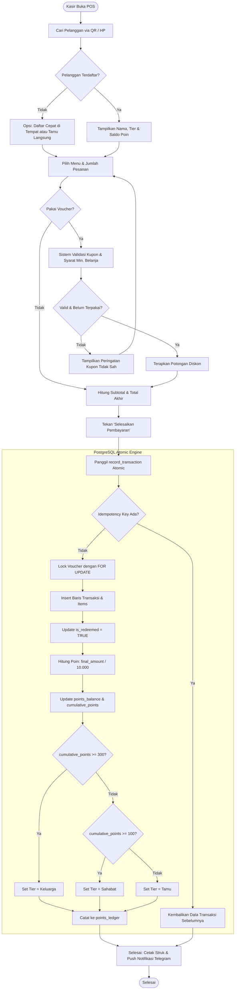
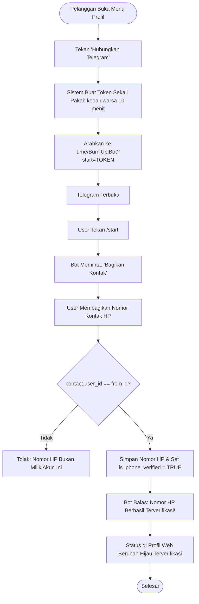
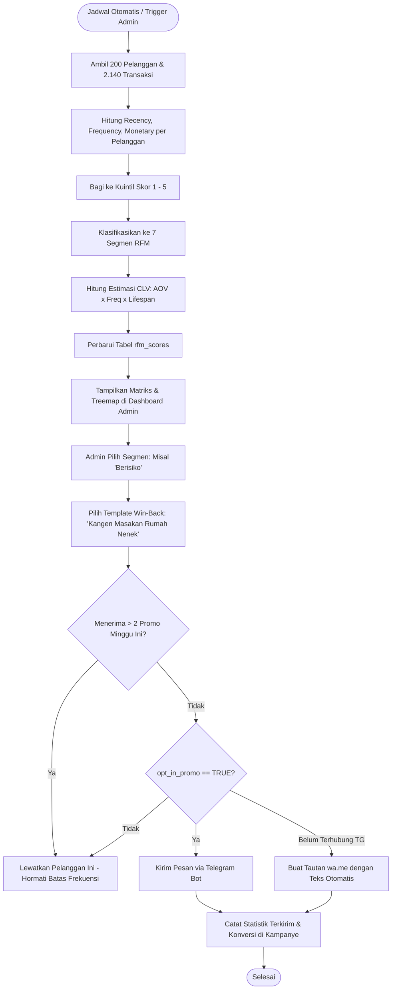

# FLOWCHARTS ALUR UTAMA SISTEM — BUMI UPI CRM
**Studi Kasus:** Rumah Tamah Bumi Upi, Garut, Jawa Barat  
**Format:** Diagram Alir Standar (Mermaid)

---

## 1. Alur Transaksi Kasir & Poin Atomic (POS Engine)

---

## 2. Alur Verifikasi Nomor HP via Telegram Deep Link

---

## 3. Alur Rekalkulasi Segmentasi RFM & Kampanye Broadcast

