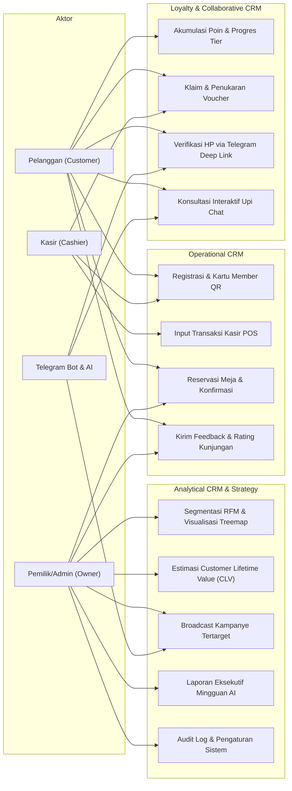

# USE CASE DIAGRAM & SPESIFIKASI — BUMI UPI CRM
**Studi Kasus:** Rumah Tamah Bumi Upi, Garut, Jawa Barat  
**Aktor Sistem:**
1. **Pelanggan (Customer):** Mengakses PWA di HP atau Telegram Bot untuk kartu loyalitas, voucher, reservasi, dan feedback.
2. **Kasir (Cashier):** Mengakses POS di Tablet/Desktop untuk mencatat pesanan, scan QR member, menerapkan voucher, dan registrasi kilat di tempat.
3. **Pemilik & Manajer (Admin / Owner):** Mengakses Dashboard Analitik untuk segmentasi RFM, estimasi CLV, kampanye broadcast, manajemen menu, AI insights, dan audit log.
4. **Telegram Bot & Upi Chat AI:** Aktor sistem otomasi interaktif.

---

## 1. Diagram Use Case (Mermaid)

---

## 2. Rincian Skenario Utama

### UC-01: Registrasi & Penerbitan Kartu Member Digital
- **Prasyarat:** Pengguna belum terdaftar.
- **Alur Utama:**
  1. Pelanggan membuka halaman register di PWA.
  2. Memasukkan Nama, Email, Nomor HP, Tanggal Lahir (opsional untuk voucher ultah), dan Password.
  3. Sistem membuat profil member secara atomic:
     - Memberikan Tier awal **"Tamu"**
     - Menghasilkan QR Code unik `BUMI-CUST-XXXX`
     - Menerbitkan **Voucher Selamat Datang** (Potongan Rp 15.000)
  4. Pengguna langsung diarahkan ke Kartu Member Digital.

### UC-02: Input Transaksi Kasir & Pembukuan Poin Atomic
- **Prasyarat:** Kasir login dengan role `kasir` atau `admin`.
- **Alur Utama:**
  1. Kasir memindai QR Code kartu member pelanggan atau mencari via nomor HP.
  2. Kasir memilih hidangan dari katalog menu (Nasi Goreng Kecombrang, Gulai Sapi, Es Cokelat, dll).
  3. Jika pelanggan memiliki voucher, kasir memasukkan kode voucher atau scan QR voucher. Sistem memverifikasi validitas, batas minimum belanja, dan masa berlaku voucher.
  4. Kasir menekan **"Selesaikan Pembayaran"**.
  5. Fungsi atomic PostgreSQL dijalankan:
     - Mencatat transaksi ke tabel `transactions` dengan `idempotency_key`
     - Mengubah status voucher menjadi `is_redeemed = TRUE`
     - Menghitung poin masuk (1 poin per Rp 10.000)
     - Menambahkan saldo poin pelanggan dan mencatat ke `points_ledger`
     - Mengevaluasi kenaikan tier (Tamu → Sahabat → Keluarga)
  6. Struk transaksi otomatis terkirim ke Telegram pelanggan secara realtime (jika akun terhubung).

### UC-09: Segmentasi RFM & Tindakan Otomatis
- **Prasyarat:** Admin login ke Admin Dashboard.
- **Alur Utama:**
  1. Admin membuka halaman **Segmentasi RFM**.
  2. Sistem menghitung skor Recency (R), Frequency (F), Monetary (M) berbasis kuintil (1-5) dari 2.140 riwayat transaksi.
  3. Sistem memetakan 200 pelanggan ke dalam 7 Segmen:
     - **Champions:** 35 pelanggan (17.5%)
     - **Loyal:** 48 pelanggan (24.0%)
     - **Potensial Loyal:** 32 pelanggan (16.0%)
     - **Baru:** 24 pelanggan (12.0%)
     - **Berisiko:** 28 pelanggan (14.0%)
     - **Hampir Hilang:** 18 pelanggan (9.0%)
     - **Hilang:** 15 pelanggan (7.5%)
  4. Admin dapat menekan tombol **"Kirim Kampanye ke Segmen Ini"** langsung dari matriks untuk mengaktifkan voucher pemulihan (win-back) atau apresiasi loyalty.
